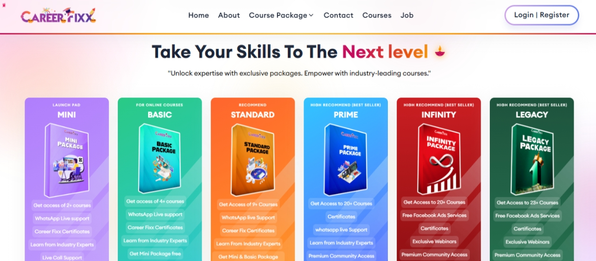
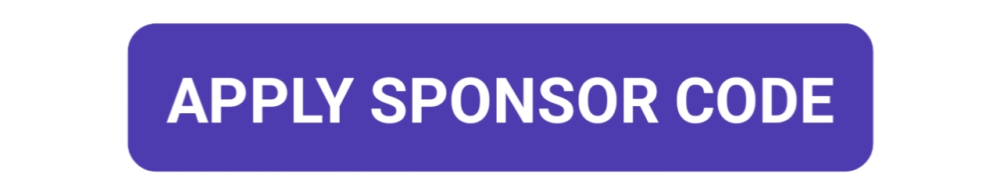

# Career Fixx 50% OFF Discount Sponsor Code for New User

Are you a new user looking to access Career Fixx courses at the best price and searching for a **working Career Fixx 50% OFF Sponsor Discount Code**? Here's something many users don't realize:

You usually **DON'T need to enter any sponsor code manually.**

The **Career Fixx sponsor discount can be automatically applied at checkout** for eligible new users.

You can get **50% OFF on Legacy, Infinity, Prime, Standard, and Basic Packages**, while the Mini Package comes with an 40% discount.

This guide covers the latest 2026 sponsor deals, package-wise discounts, pricing in India, and how to claim the maximum available discount before completing your purchase.

## 50% Off Career Fixx Sponsor Code for All Packages

The [Career Fixx 50% off sponsor code](https://careerfixx.com/?referrer_code=AZAZ75018) is one of the best ways to get extra savings on selected learning packages, especially for new users who want to develop digital skills without paying the full package price. Career Fixx offers a 50% sponsor discount on Legacy, Infinity, Prime, Standard, and Basic packages, while the Mini Package comes with a separate 40% discount. This special sponsor offer helps beginners, students, freelancers, and aspiring digital entrepreneurs reduce their course expenses while accessing different learning resources, including digital marketing, SEO, freelancing, and other online skills. The discount is automatically applied through the sponsor offer at checkout, making it easy for eligible new users to claim their savings without complicated sponsor code redemption steps.

## 50% OFF Legacy Package Sponsor Code

Use the latest [Career Fixx Legacy Package Sponsor Code to get 50% OFF on your premium learning package](https://careerfixx.com/checkout?slug=legacy-package&referrer_code=AZAZ75018). Eligible new users can claim the 50% discount, making the Legacy Package more affordable while accessing 23+ courses, free Facebook Ads services, course certificates, exclusive webinars, premium community access, priority support, freelancing project access, and advanced AI training. Whether you want to develop digital marketing skills, explore freelancing opportunities, or expand your knowledge of online business, this sponsor discount helps you access the Legacy Package at a lower price. Check the latest discounted price on the official checkout page before completing your purchase.

## CareerFixx Sponsor Code: Get 50% Extra OFF on Infinity Package

Get the [Career Fixx Sponsor Code advantage with an exclusive 50% OFF on the Infinity Package](https://careerfixx.com/checkout?slug=infinity-package&referrer_code=AZAZ75018), making it a more affordable way to access premium online learning opportunities in 2026. Learners interested in digital marketing, freelancing, web development, AI tools, and other in-demand digital skills can explore the Infinity Package at a significantly reduced price when eligible for the sponsor discount. The package advertises benefits such as access to 20+ courses, free Facebook Ads services, course certificates, exclusive webinars, premium community access, and learning from industry experts. Instead of paying the full listed price, check the available sponsor offer at checkout to see whether you qualify for the 50% discount and get more learning opportunities within your budget.

## Prime Package Sponsor Code 50% OFF

Activate [Career Fixx Prime Package 50% OFF Sponsor Discount](https://careerfixx.com/checkout?slug=prime&referrer_code=AZAZ75018), offering an 50% discount on the Prime Package for eligible new users. This limited-time sponsor deal is ideal for learners looking to develop digital skills, as the Prime Package provides access to 17+ courses, WhatsApp live support, industry expert guidance, course certificates, premium community access, Facebook Ads services, and additional benefits from the Mini, Basic, and Standard packages. By claiming this sponsor offer at checkout, users can significantly reduce their learning investment while gaining access to a wider range of digital marketing, freelancing, and online business training resources—making it an attractive learning package to consider in 2026. Verify the discount and final payable amount before completing your purchase.

## Standard Package Sponsor Code 50% OFF

Apply [Career Fixx Standard Package Sponsor Code to get up to 50% instant discount](https://careerfixx.com/checkout?slug=standard&referrer_code=AZAZ75018) on comprehensive online learning packages designed to help you develop digital skills, improve your knowledge, and explore new career opportunities. This exclusive sponsor offer is available for eligible new users, helping you access 9+ courses, WhatsApp live support, course certificates, and additional learning benefits at a significantly reduced price. Check the discounted checkout amount before completing your purchase to unlock the available savings.

## 50% OFF Basic Package Sponsor Code

The [Career Fixx 50% OFF Basic Package Sponsor Code](https://careerfixx.com/checkout?slug=basic&referrer_code=AZAZ75018) is a great way for new users to get access to multiple digital learning courses at a significantly reduced price. The Basic Package is designed for beginners who want to develop valuable online skills, with access to 4+ courses, WhatsApp live support, course certificates, and additional benefits included with the Mini Package. With the 50% sponsor discount, eligible new users can potentially cut the regular package price in half without going through complicated sponsor code redemption steps. Simply visit the Career Fixx sponsor discount page, select the Basic Package, and check whether the 50% discount is automatically applied at checkout before completing your purchase.

## Mini Package Sponsor Code 40% OFF

Activate [Career Fixx Mini Package Sponsor Code](https://careerfixx.com/checkout?slug=mini-package&referrer_code=AZAZ75018) to claim an 40% OFF discount on the Mini Package, making it an affordable starting option for beginners who want to develop digital skills without investing in a higher-tier package. This limited-time sponsor offer is ideal for new learners interested in exploring online courses, as the Mini Package includes access to 2+ courses, WhatsApp live support, course certificates, learning from industry experts, and live call support. By accessing the sponsor discount before checkout, eligible users can reduce their initial learning investment while enjoying the available course benefits. Check the final discounted price and package eligibility on the official Career Fixx checkout page before completing your purchase.

## Career Fixx Beginner Sponsor Code (Latest Deal)

- **Flat 50% OFF on Basic, Standard, Prime, Infinity & Legacy packages.**
- **40% OFF on the Mini Package for beginners.**
- **Automatic sponsor discount applied at checkout for eligible new users.**

**Important**: The biggest discount is **automatically applied when you visit Career Fixx through the sponsor [deal link](https://careerfixx.com/?referrer_code=AZAZ75018)** — no separate sponsor code needed. Simply choose your preferred package and verify the discounted price at checkout.

## How to Claim Your Career Fixx 50% Off Sponsor Code?

Claiming the [Career Fixx 50% Off Sponsor Code](https://careerfixx.com/?referrer_code=AZAZ75018) is a quick and straightforward process that usually takes just a few minutes. You can access the sponsor discount by visiting the offer page and selecting your preferred package.

**Step 1: Visit Career Fixx Website** — Visit the Career Fixx website.

**Step 2: Choose Your Preferred Package** — Select a package such as Legacy, Infinity, Prime, Standard, Basic, or Mini based on your learning goals and budget.

**Step 3: Click Apply Sponsor Code** — Put Code Sponsor Code AZAZ75018 and then click on apply to apply the sponsor code.

**Step 4: Check Auto-Applied Discount** — Review the checkout pricing carefully to confirm that the eligible 50% OFF sponsor discount (or 40% OFF for Mini) has been applied.

**Step 5: Create Your Career Fixx Account** — Proceed to checkout and enter the required registration details to create your account.

**Step 6: Verify Final Discount** — Check the original package price, applied sponsor discount, and final payable amount before proceeding.

**Step 7: Complete Payment** — Complete your payment using an available payment method to activate your selected Career Fixx package and start accessing the included learning resources.

## Career Fixx Packages and Pricing 2026 (India)

Career Fixx offers six main packages: Mini, Basic, Standard, Prime, Infinity, and Legacy.

| Packages | Code | Price | After Discount | You Save |
|---|---|---|---|---|
| Legacy (50% OFF) | [**Apply Code**](https://careerfixx.com/checkout?slug=legacy-package&referrer_code=AZAZ75018) | ₹41999 | ₹20999 | ₹21000 |
| Infinity (50% OFF) | [**Apply Code**](https://careerfixx.com/checkout?slug=infinity-package&referrer_code=AZAZ75018)  | ₹29999 | ₹14999 | ₹15000 |
| Prime (50% OFF) | [**Apply Code**](https://careerfixx.com/checkout?slug=prime&referrer_code=AZAZ75018)  | ₹19999 | ₹9999 | ₹10000 |
| Standard (50% OFF) | [**Apply Code**](https://careerfixx.com/checkout?slug=standard&referrer_code=AZAZ75018)  | ₹9999 | ₹4999 | ₹4999 |
| Basic (50% OFF) | [**Apply Code**](https://careerfixx.com/checkout?slug=basic&referrer_code=AZAZ75018)  | ₹4999 | ₹2499 | ₹2500 |
| Mini (40% OFF) | [**Apply Code**](https://careerfixx.com/checkout?slug=mini-package&referrer_code=AZAZ75018)  | ₹2499 | ₹1499 | ₹1000 |

These offers make it easier to explore the available packages without immediately committing to the full listed price.

**Note:** Career Fixx package prices, promotional offers, and sponsor discounts may change at any time without prior notice. Please visit the official Career Fixx website and verify the latest package pricing, discount eligibility, and final payable amount before completing your purchase. And this discount is for new users, Existing members upgrading their packages may receive different discounts.

**Don't miss the available sponsor offer.** Visit the Career Fixx discount page, select your preferred package, and check the final payable amount before completing your purchase.

## Hidden Trick to Get Maximum Discount

Based on the available Career Fixx sponsor offers:

- Choose the **right package (Legacy, Infinity, Prime, Standard, or Basic)** to qualify for the 50% discount.
- Use the sponsor code **AZAZ75018** at checkout.
- Compare package benefits and prices before selecting your plan.
- Check the final discounted price before completing payment.

👉 [**Apply 50% OFF Career Fixx Sponsor Discount (All Eligible Packages)**](https://careerfixx.com/?referrer_code=AZAZ75018)

## Truth About Career Fixx Sponsor Code (2026)

- No guaranteed “100% OFF” or unrealistic discount claims
- Some websites may display expired or unverified sponsor codes
- A sponsor code alone doesn't guarantee the maximum discount
- Discount eligibility may depend on the package and new eligible user

**Real method:**

- Use the Career Fixx Sponsor Discount Offer
- Select your preferred package
- Check the automatically applied sponsor discount
- Compare the final checkout price before payment
Maximum discount: 50% OFF on Legacy, Infinity, Prime, Standard, and Basic packages, while Mini offers 40% OFF.

The actual discount and final payable amount depend on current promotional terms and eligibility.

## Best Discount Sponsor Code (2026) Indian Users

### Is Career Fixx Sponsor Code Worth It?

Yes, the Career Fixx sponsor code is worth checking because it offers up to 50% OFF on selected learning packages, including Legacy, Infinity, Prime, Standard, and Basic, making its courses more affordable for Indian users who want to develop digital marketing, freelancing, web development, and other online skills. The biggest advantage is that eligible new users can get the offered sponsor discount automatically applied at checkout without manually searching for a sponsor code. However, the real value depends on the courses, support, and additional benefits included in your selected package, so compare the available options and verify the final discounted price before purchasing.

### Does Career Fixx Offer a Free Trial in 2026?

Career Fixx does not offer a free trial for its packages in 2026. Instead, it offers paid learning packages with different course access and support benefits. If you want to explore the platform before purchasing, check with Career Fixx support to see whether a free course preview or trial is currently available.

### Is any Student Sponsor Code Available?

Career Fixx does not offer a separate student-only sponsor code. However, students who qualify as new users can check the regular Career Fixx sponsor discount offer to access the 50% OFF on eligible packages. This allows [students to benefit from the same promotional pricing available to other eligible new customers](https://careerfixx.com/?referrer_code=AZAZ75018) without requiring a separate student sponsor code.

## Does CareerFixx 50% Off Sponsor Code Discount Always Work?

No promotional discount should be considered guaranteed for every user and every transaction.

Although Career Fixx offers 50% OFF on five packages, eligibility and checkout conditions can affect the final discount.

Here is what you should know.

### When the 50% Sponsor Code Works

The discount may work when:

- You are a new eligible Career Fixx customer.
- Your selected package is included in the sponsor offer.
- The promotional offer is currently active.
- Your checkout is eligible for the offered sponsor discount.
- The discount is correctly reflected in the final payment calculation.

If all applicable conditions are satisfied, you should see the discounted price before completing payment.

### When the 50% Sponsor Code May NOT Work

The discount may not apply as expected when:

- The promotion has expired or changed.
- Your selected package has different discount conditions.
- The referral or sponsor details are not being recognized.

If the discount does not appear, contact Career Fixx support before paying. Do not assume that the offered price will be applied automatically to every account.

## Terms & Conditions Of Career Fixx 50% Off Sponsor Code

Before using the Career Fixx sponsor offer, keep these conditions in mind:

1. The sponsor 50% discount applies to Legacy, Infinity, Prime, Standard, and Basic packages.
2. The Mini Package is offered with 40% OFF.
3. The displayed offer applies to eligible new users.
4. Discounts for existing customers and package upgrades may vary.
5. The promotional offer may change according to the current campaign.
6. The final payable amount should be verified before completing payment.
7. Review Career Fixx's terms, privacy policy, cancellation policy, and refund conditions before purchasing.

For the latest conditions, check the [official website](https://careerfixx.com/?referrer_code=AZAZ75018) and the payment page.

## Why Choose Career Fixx?

- Multiple digital skills courses
- Affordable learning packages
- Course completion certificates
- WhatsApp support and community access
- Freelancing and career-focused training

Designed for beginners and aspiring digital professionals.

## Conclusion: Activate Your Career Fixx 50% Off Sponsor Code (2026)

If you're planning to invest in online learning in 2026, the Career Fixx 50% Off Sponsor Code is a great opportunity to reduce your overall course cost—especially if you're a new user.

The key thing to understand is that Career Fixx offers a 50% sponsor discount on its Legacy, Infinity, Prime, Standard, and Basic packages, while the Mini Package comes with a separate 40% discount. Eligible new users can access the offer through the sponsor discount code.

Instead of wasting time searching for random sponsor codes, the best strategy is simple:

- Use the Career Fixx sponsor discount code: **AZAZ75018**
- Choose the package that matches your learning goals and budget.
- Check the sponsor discount apply at checkout.
- Verify the final discounted price before completing your payment.

This approach helps you get the available savings while accessing learning resources, course certificates, support, and additional benefits included in your selected package.

**Final Tip:** If you're serious about learning digital marketing, freelancing, web development, AI tools, or other online skills, check the current sponsor offer before purchasing. Career Fixx promotional discounts and package prices may change, so verify the latest deal before completing your registration.

👉 [Claim Your Career Fixx 50% Off Sponsor Discount Now](https://careerfixx.com/?referrer_code=AZAZ75018)

## FAQs On Career Fixx 50% Off Sponsor Code (2026)

### 1. Do I need a Career Fixx sponsor code?

A sponsor code may not need to be entered manually when using the [sponsor discount link](https://careerfixx.com/?referrer_code=AZAZ75018). Eligible discounts are automatically applied at checkout. Always verify the final price before payment.

### 2. What is Career Fixx 50% Off sponsor code?

It is a promotional sponsor discount code for selected Career Fixx packages. The current offer page lists 50% OFF on Legacy, Infinity, Prime, Standard, and Basic packages.

### 3. How do I get 50% OFF with the Career Fixx sponsor code (2026)?

Use this Career Fixx sponsor code: **AZAZ75018**, Check that the offered discount is reflected in your final payable amount before completing payment.

### 4. Does Career Fixx Offer sponsor codes for New Users?

Yes. Career Fixx offers a [sponsor discount link](https://careerfixx.com/?referrer_code=AZAZ75018) that allows new users to access the discount when purchasing a package. Existing members may have different eligibility conditions, particularly when upgrading their current packages.

### 5. Who gets the best discount?

Eligible new users selecting Legacy, Infinity, Prime, Standard, or Basic can access the offered 50% discount. Mini carries a separate 40% offer. The best overall value depends on the package features you need.

### 6. Can I stack sponsor codes?

Multiple sponsor discounts should not be assumed to be stackable.

### 7. Why is my sponsor code not working?

Possible reasons include an expired promotion, package eligibility, incorrect sponsor details, or checkout issues. Contact support and confirm the final discounted price before making payment.

👉 [Activate The Deal Before It Expires: 50% Off Code](https://careerfixx.com/?referrer_code=AZAZ75018)
